# Sample clips

One 10-second sample of each of the 23 looks, so you can see what a reel in each one looks like before you pick. Every clip is silent, made-up content (a bakery tip, a growing town, an invented company), with no real people or brands. Click a picture to open its video.

To make a reel in any of them: `/brand-setup` once, then `/bagelunit-reels`, and pick the look when it asks. For a scene style, `kit scene list` shows its scene templates and `kit start reels/<slug> --style <id>` starts one.

| Look | Id | Sample | What it is |
|---|---|---|---|
| **Print** | `print` | [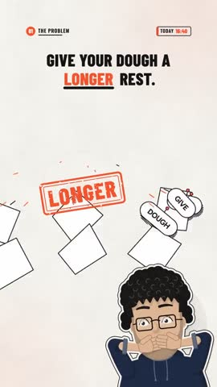](01-print.mp4) | Illustrated explainer with a drawn presenter, built on the spoken words. |
| **3D** | `depth` | [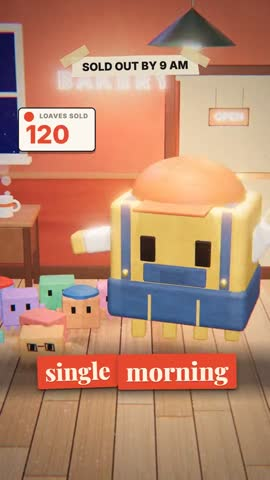](02-3d.mp4) | A small 3D diorama world with a blocky character; the first 10 seconds of a longer reel. |
| **Talking head** | `talking` | [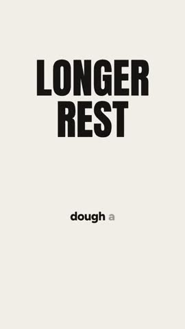](03-talking-head.mp4) | Your own camera take, cut tight, with captions and graphics. Here a made-up cartoon takes the place of a person. |
| **Anime** | `anime` |  | Cel-shaded anime episode with an original cast: here a spiky-haired hero powers up, with auras, impact frames and lip-sync. |
| **Dusty Archive** | `dusty-archive` | [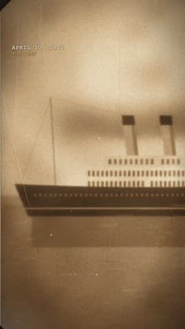](05-dusty-archive.mp4) | Dark archive desk, sepia photos, typed memos and a slow pan-and-zoom camera. |
| **Toon World** | `toon-world` | [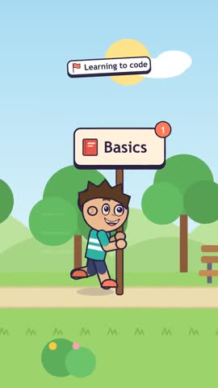](06-toon-world.mp4) | Recurring 2D cartoon cast acting out the story in illustrated worlds. |
| **Mini Chronicle** | `mini-chronicle` | [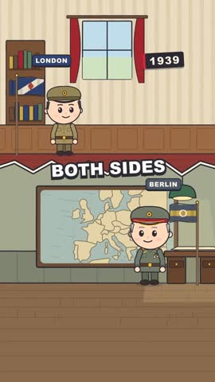](07-mini-chronicle.mp4) | Soft chibi-style history channel on painted locations. |
| **Skyline Rush** | `skyline-rush` | [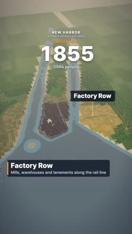](08-skyline-rush.mp4) | A city timelapse: districts and skylines that grow as you talk. |
| **Comic** | `comic` | [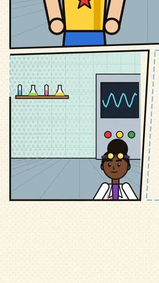](09-comic.mp4) | A living motion comic with panels, speech balloons and bursts. |
| **Doodle World** | `doodle-world` | [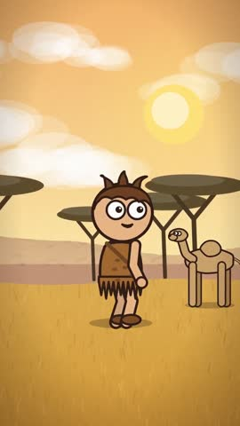](10-doodle-world.mp4) | Scrappy doodle people inside painted scenes. |
| **Clean Shapes** | `clean-shapes` | [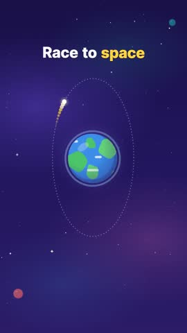](11-clean-shapes.mp4) | Flat vector explainer: orbits, timelines, charts, bold simple shapes. |
| **Origin Story** | `origin-story` | [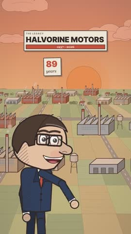](12-origin-story.mp4) | A founder-story look: milestones, skylines and company growth. |
| **Inked Body** | `inked-body` | [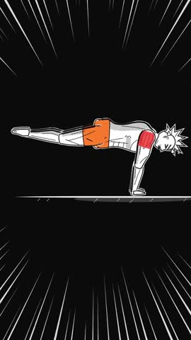](13-inked-body.mp4) | Ink anatomy diagrams for the body and movement. |
| **Tiny Cube World** | `tiny-cube-world` | [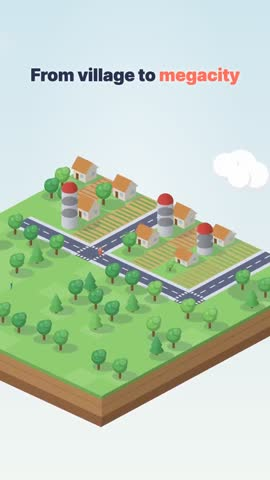](14-tiny-cube-world.mp4) | An isometric toy world that builds itself block by block. |
| **Map** | `map` | [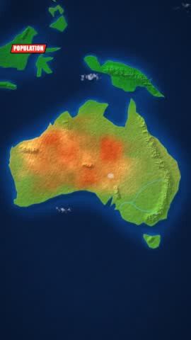](15-map.mp4) | Maps that zoom, split and highlight regions. |
| **Brush Strokes** | `brush-strokes` | [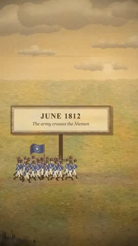](16-brush-strokes.mp4) | Painted history with banners, flags and a moving camera. |
| **Icon Signal** | `icon-signal` | [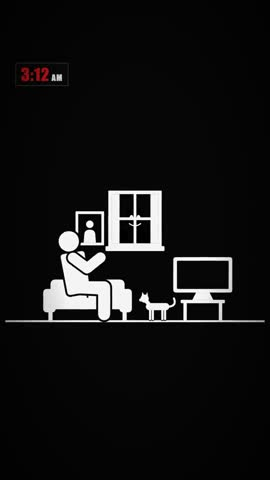](17-icon-signal.mp4) | Bold pictograms and rule scenes, readable at a glance. |
| **Pixel World** | `pixel-world` | [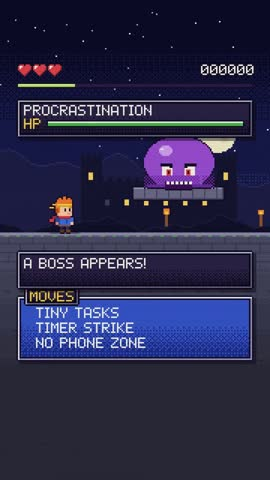](18-pixel-world.mp4) | A pixel-art quest world with bosses, items and level-ups. |
| **Stick Figure Folk** | `stick-figure-folk` | [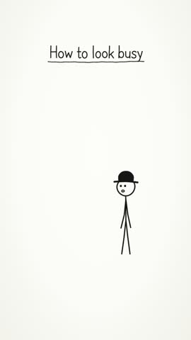](19-stick-figure-folk.mp4) | Hand-drawn stick figures and doodle lists. |
| **Paper Theatre** | `paper-theatre` | [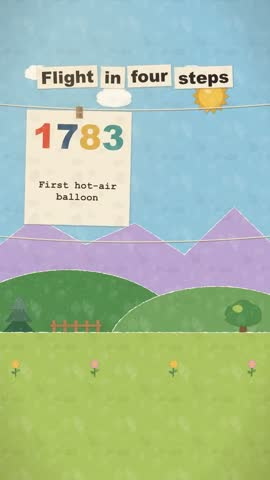](20-paper-theatre.mp4) | Paper cut-outs on a stage: clotheslines, curtains and pop-ups. |
| **Bedtime Story** | `bedtime-story` | [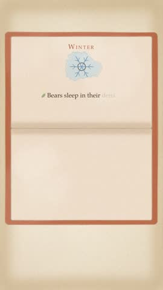](21-bedtime-story.mp4) | A painted picture-book look with page turns. |
| **Marker Board** | `marker-board` | [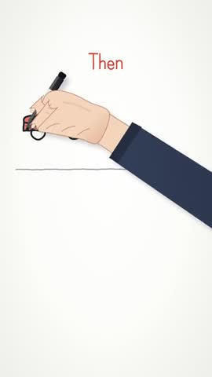](22-marker-board.mp4) | A whiteboard drawn live with markers, before and after. |
| **Deep Zoom** | `deep-zoom` | [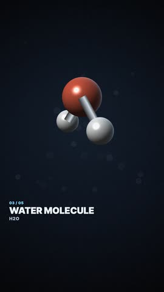](23-deep-zoom.mp4) | Cinematic 3D science documentary: glossy objects in a dark studio and dives from an ice cube down to crystals, molecules and atoms. |

The Print, 3D and Talking head clips are built with the kit's own starter reels. The other 20 are each one scene from that look's own templates (Deep Zoom's scale dive is played at about 1.5 times its speed to fit in 10 seconds).
